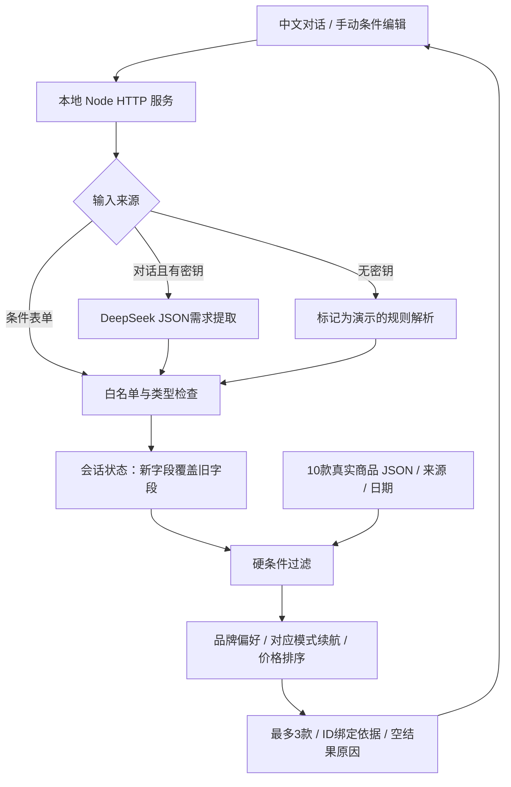

# SmartBuy — Conversational Tech Advisor

## 当前版本（2026-11-17）

公开功能演示：https://jimmycode888.github.io/smartbuy/ 。GitHub Pages 在浏览器内执行规则筛选，不调用 DeepSeek；刷新清空对话。本地 Node 版本仍支持通过服务端环境变量接入模型，但真实 API 尚未验证。运行 `node build-demo.mjs` 生成 `site/`，将其中内容发布至 gh-pages。

新增：推荐卡片逐项核对硬条件；“太贵了 / 不喜欢这款 / 更重视续航（鼠标为轻便）”反馈；五个课堂案例入口。预算与偏好需确认后才更新，不喜欢某款会提供进一步操作，不自动猜测或放宽需求。案例只预填消息，不自动发送或清空对话。历史卡片按历史需求核对并隐藏反馈按钮。支持中英文；窄屏采用单列卡片。

本次47项回归测试通过，并执行Edge交互及390px视口检查，详见 `docs/ui-checks-2026-11-17.md`、`docs/ui-regression-2026-11-17.txt`。以下各节保留此前版本开发记录；其中“未部署”和早期测试数量不代表当前状态，以本节为准。

CCC8015 本地可交互耳机选购原型。当前资料库为 **10 款耳机 + 8 款鼠标，共18款真实商品**，查询于2026-11-13。商品卡片现使用对应型号的真实商品图片；首页装饰仍为原创示意图。代码已公开；尚未部署常驻在线网站。

## 启动和使用
需要 Node.js 22+（本机验证版本24.14.0）。无第三方npm运行依赖。

```powershell
cd C:\Users\Jimmy\Documents\ChatGPT\8015\smartbuy
npm start
```
打开 http://127.0.0.1:8017 。如端口占用，先关闭此前启动该服务的终端进程，或用 `$env:PORT='8018'` 后启动并访问对应端口。

1. 输入预算、用途、佩戴方式，例如“预算800港币，学习，佩戴不限，偏好索尼”。
2. 查看当前条件、推荐依据和比较表。每张卡片可展开参数/价格来源、查询日期及未知项。
3. 继续输入“预算300”或使用“编辑”按钮更新条件。
4. 商品资料库支持按佩戴类型浏览；目录不是个性化推荐。
5. 聊天内可回看历史推荐；当前条件不随回看改变。重置清空当前会话。

## 环境变量与真实模型
复制 `.env.example` 为 `.env`，在本机填写 `DEEPSEEK_API_KEY` 后重启。`PORT`默认8017。密钥只在服务端读取，不进前端或日志，`.env`已忽略，HTTP不能访问该文件。

未配置密钥：规则演示模式。商品数据仍为真实公开资料；不代表已调用LLM。
配置密钥：DeepSeek负责需求提取；界面展示模型模式。真实调用还需验证网络、余额和权限。真实API测试当前**未执行**，不能把模拟测试写成模型测试。失败时页面明确提示且需求不更新。

## 架构与提示词


系统提示词在 `core.mjs` 的 `prompt` 常量。请求包含当前条件、上次追问、最近4轮摘要和本轮文字。模型不负责生成商品或价格。输出字段通过白名单验证；规则代码筛选，再生成绑定真实商品ID的模板解释。模型误解需求仍是风险，应核对摘要或用表单修正。

## 商品格式与证据
数据：`data/products.json`。逐款来源表及APA格式参考条目：`docs/product-sources.md`。

- `id/name/brand/type/fit`：身份、品牌、佩戴分类与子类型。
- `price/currency/region/priceType/priceSource/pricePublisher/priceEvidence`：价格、HKD、香港、RRP或页面标价、来源和证据方式。
- `anc`：true/false/null；null是本次未核实，不代表没有。
- `battery`：已核实的单次标称播放时间；`batteryAnc`：开启ANC的单次时间；`caseBattery`：含盒总时间。
- `batteryNote`记录音量、编码和ANC开关等条件。要求ANC时，最低续航采用`batteryAnc`；对应值未知不能视为满足。
- `specSources/collected/unknownFields/subjective/tradeoff`：参数链接、查询日期、未知项、主观测试状态、取舍。
- `fictional:false`。生产资料库没有虚构商品。

价格依据是查询时搜索工具可获得的源页面索引文本，不是实时结账报价。有些动态页面无脚本时显示HK$0，已拒绝作为价格使用。不承诺库存、最低价或优惠。Sony为建议零售价；小米/丰泽为页面标价，不计优惠券和运费。不同价格口径会影响排序，购买前应核对原页。

## 验证与实际结果
运行 `npm test`。

本轮20项测试全部通过，原始结果：`docs/test-results.txt`。
- 1–16：确定性筛选、演示解析、未知字段、价格/来源数据完整性及8个必测情境。
- 17：真实本地HTTP演示多轮、表单修改、重置。
- 18、20：模拟模型故障和模拟JSON输出，**不是实际DeepSeek调用**。
- 19：公共资源不泄露测试密钥，`.env`返回404。

Edge浏览器实际操作与观察见 `docs/browser-checks.md`，截图 `docs/preview.png`。已检查JS语法。未执行手机视口测试、真实模型测试或独立产品性能实测。旧 `http-results.txt`、`upgrade-http-results.json`仅是此前虚构数据版本的历史记录，不能作为当前真实数据验收依据。

## 约2分钟课堂演示
- 0:00 说明学生预算和参数理解问题；指出真实资料与规则演示模式两个独立标签。
- 0:15 输入“推荐一个好耳机”，观察追问预算。
- 0:30 依次回复“800”“学习”“佩戴不限”，查看真实推荐。
- 0:50 输入“偏好索尼”，展示品牌只是排序偏好；展开来源与未知项。
- 1:10 输入“预算200，不接受入耳式”，展示空结果与保留条件。
- 1:25 编辑预算1000、必须ANC，确认排除入耳仍然生效，推荐WH-CH720N。
- 1:40 比较50小时（关闭ANC）与35小时（开启ANC），说明数据条件为何重要。
- 1:55 回看历史推荐并重置。

10分钟结构建议：问题1分钟、架构/提示词2分钟、操作2分钟、至少5个测试与失败分析2分钟、伦理/限制2分钟、真实贡献1分钟。

## 已实现与局限
已实现：真实静态数据库、中文工作台、目录筛选、对话与条件表单、硬条件管理、偏好排序、来源/日期、比较表、历史回看、重置、服务端DeepSeek接口和错误反馈。

待办：配置并实际测试DeepSeek、扩展品牌和型号、补全未知参数、用户研究、手机端与完整无障碍验证。没有登录/支付/购物车/下单（范围外）。没有公开部署。

限制：只有Sony/Xiaomi两组品牌，部分型号较旧，非全市场比较；价格可能来自缓存，RRP与零售标价不同。用途给出相关注意事项，但不凭用途声称音质、低延迟、运动防水已满足。所有续航是厂商上限，非保证。规则模式语言覆盖有限；模型也可能误提取条件。无法证明对所有提示词攻击免疫。数据与价格字段不接受模型修改，但模型需求误提取仍需防范。会话仅存服务内存，刷新页面新建会话，重启丢失；本地原型没有生产级身份认证。

伦理：不收集敏感个人资料；模型模式会把对话需求发给DeepSeek。无联盟佣金、虚构用户评价或主观音质评分。需求与测试结果应诚实披露。

## 依赖、代码与成员贡献
零第三方npm运行依赖；使用Node.js内置模块、浏览器标准API与系统字体。Node.js发行版保留其许可证。本项目未指定公开开源许可证。首页SVG原创；商品卡片外链引用厂家/零售商图片，版权归原权利人，来源见 docs/image-sources.md。公开产品事实经人工整理并链接来源，不复制评价或长文。

借鉴以下项目的架构与交互思路，未复制代码：
- Redis Developer. (n.d.). *Shopping AI Agent with LangGraph.js* [Computer software]. https://github.com/redis-developer/shopping-ai-agent-langgraph-js-demo 。已核实MIT（Ashwin Hariharan，2025）；若未来复制代码需保留版权/许可证。不采用其无结果自动移除category逻辑。
- aakar-sonawane. (n.d.). *Bluetooth Headphones Recommendation Chatbot* [Computer software]. https://github.com/aakar-sonawane/BLUETOOTH-HEADPHONES-RECOMMENDATION-CHATBOT 。已读README，许可证尚未确认，未复制代码。
- Redis Developer. (n.d.). *LangChain retail chatbot* [Computer software]. https://github.com/redis-developer/langchain-retail-chatbot 。已读README，未运行。

当前实现由AI辅助生成。A/B/C/D的分工仍只是计划；报告/PPT第一页应填写姓名、实际贡献、提交/核查证据，不预先认领未完成工作。报告上限3000英文单词，参考文献采用APA；本次不生成完整报告/PPT。

## 商品图片更新（2026-11-14）
10款商品均已配置真实型号图片与可点击来源。浏览器实际验证10/10加载成功；加载失败有文字提示。完成前端JavaScript语法检查。本次只调整图片与展示，未重新执行模型测试。

## 中英文界面（2026-11-14）
右上角语言菜单切换“简体中文 / English”。默认中文，选择保存在浏览器localStorage。仅切换展示语言，不改需求值、不清除对话、不发模型请求；用户原始消息保留输入时文字。刷新仍按原规则新建会话，但语言偏好保留。

覆盖导航、需求摘要/表单、目录、推荐依据、系统追问/回复、商品事实与取舍、比较表、来源、错误提示、占位文字及主要无障碍标签。厂商来源链接指向原始网页，外部页面不自动翻译。

实现：public/i18n.js负责展示层翻译，public/translations.txt保留中文/英文对应文案。文本原值缓存用于还原中文；选项value保持规范中文值，显示英文也不改变筛选数据。新增动态文案时应同步补充翻译词典；自由用户输入不会自动翻译。

演示模式支持常见英文需求，如“Budget 800 HKD, commuting, no in-ear”“require ANC”“at least 30 hours”“prefer Sony”。并非完整英文自然语言理解。真实DeepSeek仍未配置、未测试。

实际验证：22项回归测试通过（docs/test-results.txt）。Edge实测英文需求返回与中文相同的两款；中→英→中切换保留HKD800/通勤/排除入耳与结果；英文表单选择Headband并保存成功；刷新后English偏好保留；英文商品卡片和比较表正常显示。截图：docs/english-interface.png。移动端语言布局未做完整实测。


## 新增鼠标品类（2026-11-14）
入口为页面上方“耳机 / 鼠标”，两类各有需求、聊天历史与结果，切换保留，重置只清当前品类；刷新仍新建会话。鼠标编辑器和比较表使用专用字段，不出现ANC、佩戴类型等耳机条件。中英文均可用。

新增8款：M185、M240 Silent、M331 Silent Plus、Pebble Mouse 2 M350s、Signature M650（标准右手）、M720 Triathlon、Lift（右手）、G304 LIGHTSPEED。资料文件data/mice.json；逐款证据与APA条目见docs/mouse-sources.md。

鼠标核心在mouse.mjs：独立白名单、提示词、规则理解、过滤与排序。服务器按category+session ID保存；LLM只提取当前品类字段。鼠标预算/连接/USB-A可用性/电脑蓝牙/左右手/必须静音/最高重量为硬条件，静音与轻便偏好只排序。未知参数不能满足相应硬条件。接口未知时若用户选择任意连接，先按未排除的已确认产品能力匹配，卡片明确连接方式；USB-C-only必须追问电脑蓝牙。系统版本不在过滤字段中，不能声称保证全设备兼容。

演示输入：“预算300，办公，只有USB-C” → 追问蓝牙 → “支持蓝牙” → 推荐三款；“左手使用” → 保守排除右手/未知，保留M240。英文例：Budget 300 HKD, office, USB-C only。英文规则模式覆盖有限；可用条件表单纠正。

鼠标图片作为本地静态文件提供，不再依赖实时外链；耳机图片仍是外链。版权/来源见mouse-sources.md。

最终验证：33项测试通过，含10项鼠标筛选/会话测试及1项本地图片测试；docs/test-results.txt保存原始输出。Edge实际验证两品类切换保留各自预算和对话、鼠标中英文展示、USB-C追问、左手表单筛选、本地图片显示。截图docs/mouse-advisor.png。真实DeepSeek仍未配置/未调用，未公开部署。鼠标库目前仅罗技，字段有缺失，尚未开展真实用户/握持或延迟测试，也未完成手机视口测试。

架构扩展：品类选择 → 独立会话 → 对应品类提示词/规则解析 → 专属字段校验 → 对应数据库硬条件过滤 → 偏好排序 → 最多3款与专属比较表。现有README中仅耳机的流程和历史测试数量描述属于此前版本，请以本节和最终测试记录为准。

## 选购决策功能（2026-11-14）
新增四项功能，两品类共用：

1. **候选追问**：输入“为什么推荐第一款”“M240和M350s差在哪”“有没有更便宜的”“第一款防水吗”。根据明确型号、候选顺序或自选比较ID回答，原条件不变。更便宜表示比当前候选最低价格更低，同时仍满足全部硬条件；没有则明确说明。未核实体验与防水等字段不编造。
2. **条件变更回执**：摘要下显示本轮修改字段及旧值→新值，其余条件保留。此处是已执行修改的可核对回执，不是二次确认弹窗。商品解释类追问显示“当前条件保持不变”。
3. **自选比较**：推荐卡片/资料库可勾选最多3款，页面下方比较区展示所选数据和条件符合状态，支持移除/清空。可比较超预算等不符合条件的商品，但会标记，不会将它们伪装成推荐。“解释所选商品差异”将已选ID交给服务端校验。
4. **空结果调整预览**：服务端尝试单项调整，保留其他条件，最多给3项可行方案。例如头戴式/预算200时可提高预算至399，或取消佩戴限制。只预览，不自动改条件；点击“应用方案”才修改。方案ID绑定当时的完整条件，过期方案拒绝应用。不会自动假设电脑新增接口或蓝牙，也不会主动变更左右手等物理事实。若单项调整仍无结果则不生成虚假方案。

核心文件：advisor.mjs（依据库回答/方案/条件差异）；public/advisor-ui.js（自选比较/回执/应用方案）；server.mjs（会话与动作校验）。比较或原因解释走确定性模板，不调用模型生成产品事实。一般需求提取在已配置密钥时使用DeepSeek；否则规则演示。当前无DEEPSEEK_API_KEY且无.env，因此真实连接**未执行**，不能当作LLM验证通过。要验证，请复制.env.example为.env，在本机填写密钥并重启npm start，勿将密钥发到聊天或写入前端。

新增架构：用户消息 → 明确条件修改优先 / 商品追问路由 → 品类资料库与有效ID校验 → 约束回答；无结果 → 单字段调整模拟 → 用户点击 → 校验方案与最新状态 → 更新条件并重新筛选。

### 约2分钟新版演示
- 0:00 耳机输入“预算200，学习，头戴式”，展示无结果与两项调整预览；预算保持200。
- 0:20 点击提高预算399方案，摘要出现200→399，仅推荐WH-CH520。
- 0:40 输入“为什么推荐第一款”，展示真实参数、来源、未知项，条件不变。
- 1:00 在资料库勾选WH-CH520与WH-CH720N，比较区明确标记后者超预算；点击解释差异。
- 1:25 切鼠标，输入“预算300，办公，蓝牙”；自选M240/M350s/M650，查看重量和左右手未知项。
- 1:45 切英文展示，并说明规则模式、静态价格与真实模型未验证的边界。

最终验证记录：47项测试全部通过，原始输出docs/test-results.txt。包含真实可行的更便宜替代、无替代、未知字段、自选ID伪造、过期方案、混合预算修改与比较意图、第一候选引用及API会话状态检查。Edge实际验证空结果预算200不变、点击方案变399、追问不改条件、自选超预算标记、三款上限、鼠标比较和英文展示；截图docs/advisor-comparison.png。测试中的模型故障/输出仍为模拟，真实API测试未执行。

局限：追问路由识别常见中英文表达，复杂自由问法仍可能进入需求解析或无法理解；解释是结构化模板，不是自由生成长篇购买意见。调整方案只搜索一次改变一个条件的情况，不保证找到所有组合或最优折中。当前无登录与生产级身份隔离，仍为本地课堂原型。比较区的条件核对为浏览器展示辅助；服务端才是推荐硬过滤的权威。资料库缺失项与外链价格限制继续适用。

## GitHub 运行（2026-11-16）
仓库已按用户授权公开：https://github.com/jimmycode888/smartbuy 。Code → Codespaces → Create codespace on main，启动后打开 Ports 中的 8017（默认私有）。Codespaces 可能消耗账号额度，请在使用后停止。可在 Codespaces Secrets 配置 DEEPSEEK_API_KEY 后重建/重启环境，未配置时为演示模式。GitHub Pages 无法运行本项目 Node 后端。Docker 可用 docker build -t smartbuy . 和 docker run --rm -p 8017:8017 --env-file .env smartbuy。完整托管网站仍需支持 Node/Docker 的平台，未创建公共网址。


